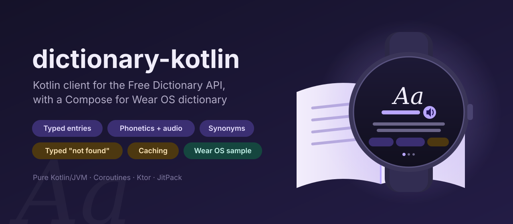
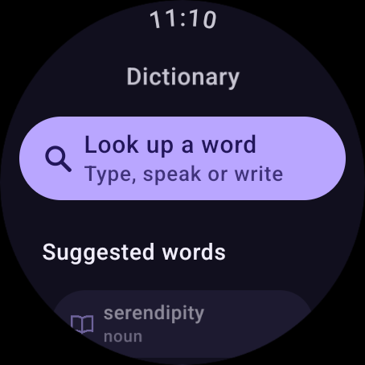
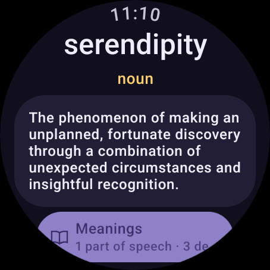
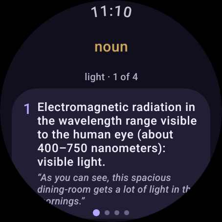

<p align="center">
  
</p>

<p align="center">
  <a href="https://github.com/halilozel1903/dictionary-kotlin/actions/workflows/ci.yml"></a>
  <a href="https://jitpack.io/#halilozel1903/dictionary-kotlin"></a>
  
  
  
  
  
  <a href="LICENSE"></a>
</p>

**dictionary-kotlin** is a Kotlin client for the [Free Dictionary API](https://dictionaryapi.dev), a free English dictionary with no API key, built from Wiktionary. Look a word up with one `suspend` call and get typed entries: the word, its phonetic transcriptions with pronunciation recordings (absolute https MP3 urls, with their accent), its meanings by part of speech, definitions with example sentences, synonyms and antonyms, the source pages and licenses. A word the dictionary does not know comes back as a typed `LookupResult.NotFound` with the API's own "No Definitions Found" texts, not as an exception. Answers are cached, including "not found" ones, and identical lookups running at the same time share one request.

A second keyless source, **Wiktionary's own REST API**, can be selected with `source = DictionarySource.Wiktionary` and answers with the same model (parts of speech, definitions and examples, but no phonetics, recordings or, in practice, synonyms).

The library is pure Kotlin/JVM (Ktor and kotlinx.serialization), so it runs on Android, Wear OS, the server and in tests. The sample is a **Wear OS pocket dictionary** built with Compose for Wear OS and Material 3.

```kotlin
val dictionary = DictionaryClient()

when (val result = dictionary.lookup("serendipity")) {
    is LookupResult.Found -> {
        val word = result.lookup
        word.phonetic                          // the IPA transcription, e.g. "/ˌsɛɹ.ənˈdɪp.ɪ.ti/"
        word.pronunciation()?.audioUrl         // an https MP3, US accent first, or null
        word.partsOfSpeech                     // e.g. [noun]
        word.firstDefinition?.definition
        word.synonyms; word.antonyms
    }
    is LookupResult.NotFound -> println(result.title)   // "No Definitions Found"
}
```

## Screenshots

Captured by CI on a Wear OS emulator (large round) with **live data**: every screen looks its words up during the run, with no cache and no recorded responses. Before the emulator starts, CI asks the Free Dictionary API (`api.dictionaryapi.dev`) for a word. If it answers, the screenshots use it. If it refuses, as its Cloudflare protection currently does for GitHub's runners (an HTTP 403 challenge for any User-Agent), the sample is started with Wiktionary's REST API (`en.wiktionary.org`) instead, the other source this library supports. If neither answers, an entry cannot be loaded or a word is unknown, the screenshot step fails and the old screenshots stay. The synonyms screen is not pictured: Wiktionary's definition endpoint has no synonyms, so the screenshots stick to the screens both sources fill. JSON fixtures are used only by the unit tests.

CI writes the next line on each run:

<!-- screenshot-source -->
No screenshots have been captured yet.
<!-- /screenshot-source -->

| Lookup | Word | Meanings |
| :---: | :---: | :---: |
|  |  |  |

## Features

- **Typed entries**: `WordEntry` with `word`, `phonetic`, `phonetics`, `origin`, `meanings`, `license` and `sourceUrls`; `Phonetic` with `text`, `audioUrl`, `sourceUrl`, `license` and the recording's `accent` (`US`, `UK`, `AU`, ...); `Meaning` by part of speech; `Definition` with its `example`, `synonyms` and `antonyms`.
- **One word, one view**: the API can answer with several entries for one spelling (one per etymology). `WordLookup` keeps them and merges them for display: one phonetic, meanings merged by part of speech, every synonym and antonym once, every example, recordings without repeats.
- **Pronunciation**: `pronunciation("US", "UK")` picks the recording in the accent you prefer; empty audio fields become `null` and old protocol-relative urls (`//ssl.gstatic.com/...`) get `https:`.
- **Typed "not found"**: HTTP 404 `{"title":"No Definitions Found", ...}` is `LookupResult.NotFound(query, title, message, resolution)`. Real failures throw a `DictionaryException`: `Network`, `RateLimited` (429, with `Retry-After`), `Http` (5xx) or `Decoding`.
- **Lenient parsing**: missing, `null` or empty fields never fail a lookup.
- **Caching**: in-memory LRU by default. Found words stay fresh for 7 days, "not found" answers for an hour (so a typo is not requested again and again), and an expired answer is still used when the watch is offline. Plug in your own `DictionaryCache` to keep words across app starts.
- **Recent lookups**: `RecentLookups`, a small most-recent-first list without duplicates, easy to save in SharedPreferences or DataStore.
- **Coroutines**: every call is main-safe; identical lookups running at the same time share one network call. Words are trimmed, whitespace is collapsed and they are lowercased, so "Hello " and "hello" share one cache entry; phrases like "ice cream" work.
- **Pluggable HTTP**: Ktor with the CIO engine by default; pass OkHttp, Android or Java, a `MockEngine`, a ready `HttpClient`, or replace HTTP with your own `DictionaryTransport`.
- **Two keyless sources**: the Free Dictionary API (default) or Wiktionary's REST definition endpoint (`DictionarySource.Wiktionary`), mapped into the same `WordLookup`. Wiktionary's definition HTML becomes plain text. That endpoint has no phonetics or recordings, so `phonetic` and `pronunciation()` are `null`, and in practice no synonyms (an inline nym list, when a definition has one, is read into `Definition.synonyms` and `antonyms`).
- **Explicit API**, unit tested against JSON fixtures in each API's response format (no network in tests).

### API

| Free Dictionary API request | Function | Returns |
| --- | --- | --- |
| `GET /api/v2/entries/en/{word}` | `lookup(word)` | `LookupResult` (`Found` or `NotFound`) |
| `GET /api/v2/entries/en/{word}` | `lookupOrNull(word)` | `WordLookup?` |
| Wiktionary: `GET /api/rest_v1/page/definition/{word}` | `lookup(word)`, `lookupOrNull(word)` with `source = DictionarySource.Wiktionary` | the same, without phonetics |
| (none) | `urlOf(word)`, `evict(word)`, `clearCache()` | the request url; cache control |

| Model | Members |
| --- | --- |
| `LookupResult.Found` | `query`, `lookup: WordLookup` |
| `LookupResult.NotFound` | `query`, `title` ("No Definitions Found"), `message`, `resolution` |
| `WordLookup` | `word`, `entries`, `phonetic`, `phonetics`, `pronunciations`, `pronunciation(vararg accents)`, `phoneticFor(phonetic)`, `meanings`, `partsOfSpeech`, `meaning(partOfSpeech)`, `definitions`, `firstDefinition`, `synonyms`, `antonyms`, `examples`, `sourceUrls`, `licenses` |
| `WordEntry` | `word`, `phonetic`, `phonetics`, `origin`, `meanings`, `license`, `sourceUrls` |
| `Phonetic` | `text`, `audioUrl`, `sourceUrl`, `license`, `accent`, `hasAudio` |
| `Meaning` | `partOfSpeech`, `definitions`, `synonyms`, `antonyms`, `allSynonyms`, `allAntonyms`, `examples` |
| `Definition` | `definition`, `example`, `synonyms`, `antonyms` |
| `RecentLookups` | `add(word)`, `remove(word)`, `clear()`, `toList()`, `size`, `maxSize` |
| `DictionaryJson` | `parseEntries(body)`, `parseNotFound(query, body)` |
| `WiktionaryJson` | `parseEntries(word, language, body)`, `pageUrl(word)`, `LICENSE` |
| `DictionarySource` | `FreeDictionary`, `Wiktionary`; `defaultBaseUrl`, `displayName` |

## Installation

Add JitPack to `settings.gradle.kts`:

```kotlin
dependencyResolutionManagement {
    repositories {
        google()
        mavenCentral()
        maven("https://jitpack.io")
    }
}
```

Then the dependency:

```kotlin
dependencies {
    implementation("com.github.halilozel1903.dictionary-kotlin:dictionary:1.0.0")

    // Optional: use OkHttp instead of Ktor's CIO engine.
    implementation("io.ktor:ktor-client-okhttp:3.6.0")
}
```

> The build is also set up for Maven Central (`io.github.halilozel1903:dictionary`) via the vanniktech publish plugin.

`dictionary` is a plain Kotlin/JVM library (JDK 17+), so it also works in server and desktop projects.

## Usage

**Create a client**

```kotlin
val dictionary = DictionaryClient {
    source = DictionarySource.FreeDictionary     // or DictionarySource.Wiktionary
    engine = OkHttp.create()                     // default: CIO
    cache = DictionaryCache.memory(maxEntries = 32)
    cachePolicy = CachePolicy.CacheFirst         // or FreshOnly, NetworkOnly
    foundTtl = 7.days
    notFoundTtl = 1.hours
    requestTimeoutMillis = 15_000
    retries = 2                                  // network errors and 5xx, with backoff
}
// ...
dictionary.close()
```

Create one client and share it; it is safe to use from many coroutines.

**Use Wiktionary instead**

```kotlin
val wiktionary = DictionaryClient {
    source = DictionarySource.Wiktionary
    userAgent = "MyApp/1.0 (https://example.com/contact)"   // Wikimedia asks for a way to contact you
}
val word = wiktionary.lookupOrNull("happy") ?: return
word.definitions                                 // plain text, from Wiktionary's definition HTML
word.synonyms                                    // usually empty: this endpoint has no synonym lists
word.pronunciation()                             // null: this endpoint has no recordings
```

Wiktionary titles are case-sensitive; like the Free Dictionary API source, the client lowercases the word.

**Look a word up**

```kotlin
val word = dictionary.lookupOrNull("light") ?: return

word.meanings.forEach { meaning ->
    println(meaning.partOfSpeech)                // noun, verb, adjective, ...
    meaning.definitions.forEachIndexed { i, d ->
        println("${i + 1}. ${d.definition}")
        d.example?.let { println("   \"$it\"") }
    }
}
word.meaning("verb")?.allSynonyms
word.sourceUrls                                  // the Wiktionary page(s)
word.licenses                                    // CC BY-SA 3.0
```

**Play the pronunciation (Android)**

```kotlin
val recording = word.pronunciation("US", "UK") ?: return   // null when the dictionary has no recording
MediaPlayer().apply {
    setDataSource(recording.audioUrl)
    setOnPreparedListener { it.start() }
    prepareAsync()
}
```

**Not found and errors**

```kotlin
try {
    when (val result = dictionary.lookup(query)) {
        is LookupResult.Found -> show(result.lookup)
        is LookupResult.NotFound -> showMessage(result.title, result.message)   // the API's texts
    }
} catch (e: DictionaryException.RateLimited) {
    // wait e.retryAfterSeconds
} catch (e: DictionaryException.Network) {
    // offline: with CachePolicy.CacheFirst an older cached answer is returned instead, when there is one
}
```

A blank word throws `IllegalArgumentException` before any request is made.

**Recent lookups**

```kotlin
val recent = RecentLookups(maxSize = 10, restored = prefs.getString("recent", "")!!.lines())
recent.add("serendipity")
prefs.edit { putString("recent", recent.toList().joinToString("\n")) }
```

## Wear OS sample

The [`sample`](sample) module is a standalone Wear OS app (Compose for Wear OS, Material 3) built on this library:

- **Lookup**: a button that opens the watch's text input (keyboard, voice or handwriting), a short list of suggested words with their phonetic and part of speech, and your recent lookups (kept with `RecentLookups` in SharedPreferences).
- **Word**: the word, its phonetic, a play button for the pronunciation recording (hidden when the source has no recording), its parts of speech and its first definition with an example. Words the dictionary does not know show the API's "No Definitions Found" message.
- **Meanings**: a horizontal pager with one page per part of speech, numbered definitions and examples.
- **Synonyms**: synonyms and antonyms as chips; tap one to look it up. The word screen offers it only when the word has some.

Lists use `TransformingLazyColumn` in a `ScreenScaffold`, so items morph at the round edges and stay clear of the time; swipe right or press back to go back. Screenshots are made by `scripts/screenshots.sh` on the CI emulator: it opens each screen with `--es scene lookup|word|meanings` (the app also has a `synonyms` scene) and the live source with `--es source freedictionary|wiktionary`, waits for the app to log `SCENE_READY` after the live entry is on screen, and fails on `SCENE_FAILED`.

## Credits

Definitions by the [Free Dictionary API](https://dictionaryapi.dev) ([source](https://github.com/meetDeveloper/freeDictionaryAPI)), built from [Wiktionary](https://en.wiktionary.org) content under CC BY-SA, or by Wiktionary's [REST API](https://en.wiktionary.org/api/rest_v1/) directly (text under CC BY-SA 4.0). Each entry carries its license and source urls; show them when you display definitions. This library is not affiliated with the Free Dictionary API or Wiktionary.

## License

MIT License. Copyright (c) 2026 Halil Özel. See [LICENSE](LICENSE).
